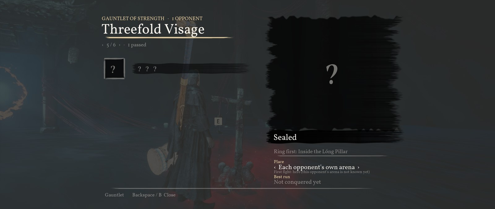
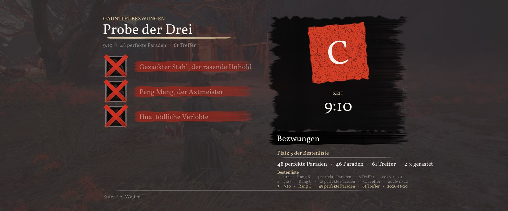
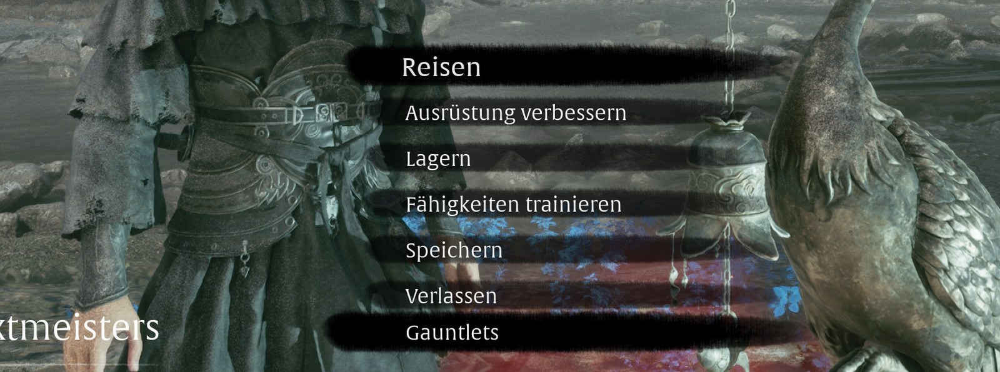
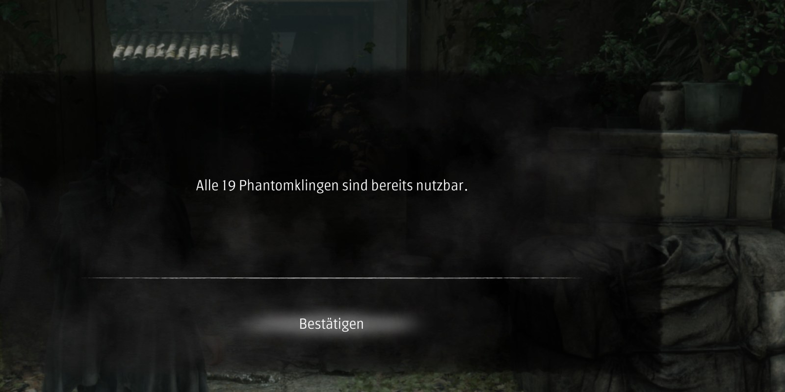
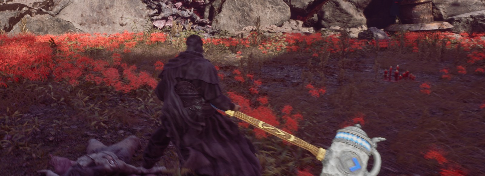
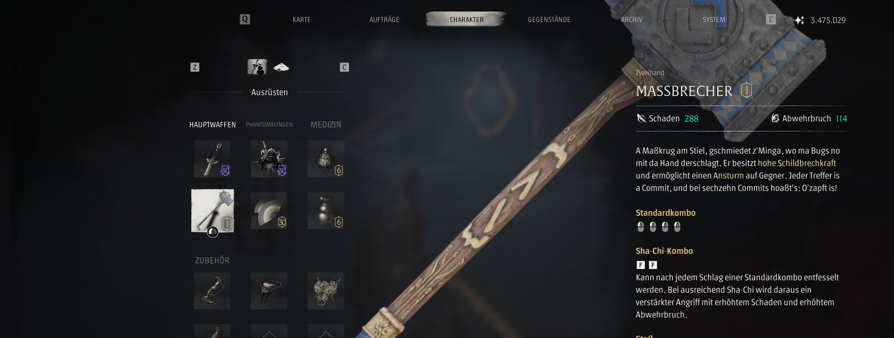

# Phantom Blade Zero Mods

Script mods for the Steam version of **Phantom Blade Zero**. They are JavaScript files for
[PBZModLoader](https://github.com/KintaroModding/phantombladezero_pbzmodloader) and change no game files.

| Mod | What it does | State |
| --- | --- | --- |
| [Gauntlets](#gauntlets) | Boss rush: runs of boss fights with ranks, best times and vows | Playable, in development |
| [NG+ Phantom Edges](#ng-phantom-edges) | Unlocks the Phantom Edges you already own in New Game+ | Stable |
| [Jetpack](#jetpack) | Free flight for exploring | Works, no longer developed |
| [Maßbrecher](#maßbrecher) | A beer-stein war hammer in place of the Army Breaker | Experimental |

The screenshots are from development and show the game in German. Some of them are from older versions of
a mod; the Gauntlets' own texts are English now.

## Installation

1. Install [PBZModLoader](https://github.com/KintaroModding/phantombladezero_pbzmodloader) (2.1.0 or later)
   as its own guide says.
2. Download this repository (Code > Download ZIP) and unpack it.
3. Copy the folder of each mod you want into the loader's `mods` folder, with its name unchanged:

   `<Steam>\steamapps\common\PBZ\ProjectPBZ\PBZModLoader\mods\`

   | Folder | Mod |
   | --- | --- |
   | `boss-gauntlets` | Gauntlets |
   | `ngplus-phantom-edges` | NG+ Phantom Edges |
   | `jetpack` | Jetpack |
   | `massbrecher` | Maßbrecher |

   Each mod folder must hold its `main.js` directly, for example `modsoss-gauntlets\main.js`.
4. Start the game. With the game running, **Alt+F5** reloads all mods.

To remove a mod, delete its folder from `mods`. What a mod does and any error it meets is written to
`ProjectPBZ\PBZModLoader\loader.log`.

Back up your save games before you try mods:
`<Steam>\steamapps\common\PBZ\ProjectPBZ\Saved\SaveGames`.

## Gauntlets

A run of boss fights, one after the other, in the manner of a boss rush. You fight one opponent; when it
has fallen you choose when to call the next. The opponents after the next one stay hidden. When your health
runs out the run is over. You do not really die: no death is counted and nothing is lost.

- **Nine trials**, one for each region of the game and so growing harder, with three to six opponents
  each: Valley, Forest, Village, Mandate, Town, Lake, Masks, Estate, Soulrend. Apart from these, "Trial of
  Puppets" gathers the puppets and their puppeteer, and "Twin Visage" is the odd one, two opponents at once. The last, "Trial of Mortals", holds all 33 opponents and stays sealed until
  the nine trials are won.
- **Each opponent in its own arena**, with its own boss music. The game's own travel takes you there and
  back. A gauntlet is sealed until you have rung the bells of its arenas in your playthrough.
- **Closed arenas**: the arena's fog doors shut while its boss is fought, as in the game.
- **Vows** make a run harder: No Rest, Frenzy (opponents act a third faster), Might (opponents are 20
  levels stronger), Pure Blade (a hit or an ordinary block ends the run).
- **Ranks and best runs**: a win is ranked S (no hit taken) to C and the ten fastest wins of each gauntlet
  are kept. A gauntlet you have won is marked as passed.

**How to open it:** at a bell, the bell's menu has a new entry "Gauntlets" at its end. Anywhere else press
**G** (gamepad: hold L3 and press D-pad up).

| On the board | Keyboard | Gamepad |
| --- | --- | --- |
| Another gauntlet | Left / Right | D-pad |
| Choose a vow, take it or drop it | Up / Down, Delete | D-pad, X (Square) |
| Another arena | Tab / R | Y (Triangle) |
| Start, or call the next opponent | Enter / Space | A (Cross) |
| Rest between two fights (once per stop) | Tab / R | Y (Triangle) |
| Close | Backspace / G | B (Circle) |
| Give up a run, or delete a gauntlet's best runs | Delete, twice | X (Square), twice |

Known limits: the mod is still being tested. Many of the 33 opponents have not been fought in a trial
yet: an opponent may arrive at the wrong place or a later form may fail to take over. Bosses that ride
(Jing Ye, Chang Hong) have had bugs. Fights that depend on their arena's own machinery are left out.

## NG+ Phantom Edges

In New Game+ the game keeps your Phantom Edges but locks each one until you find it again. This mod unlocks
the ones you already own.

Press **K** while you play (gamepad: hold both sticks down, L3 + R3). The mod asks before it unlocks. Press
the key again when everything is unlocked and it offers to undo what it unlocked. With
Mods Menu 0.9.0 or later the mod also has a page with one switch in the Mods tab of the game's settings.

## Jetpack

Free flight, for exploring and screenshots. Press **J** (gamepad: L1 twice quickly) to switch it on and off.

| While it is on | Keyboard | Gamepad |
| --- | --- | --- |
| Fly where the camera looks | W A S D | Left stick |
| Straight up | Space | A (Cross) |
| Straight down | Left Ctrl | B (Circle) |
| Boost | Left Shift | L2 |

With nothing pressed you hover. Walls and floors still stop you. The speeds are settings at the top of
`main.js`.

## Maßbrecher

A two-handed Bavarian war hammer with a beer stein for a head. It takes the place of the Army Breaker: the
hammer is shown in the hand, on the HUD and in the character menu, with the Army Breaker's moves and levels.

While the mod is on (**B** switches it off and on), every hit you land is a "commit": +2.5 % attack each,
up to 16. A perfect parry or dodge gives two commits and a little health, a hit you take halves them, and
at 16 commits you get 12 seconds of +60 % attack.

This one is an experiment, and it shows:

- The hammer is drawn without the scene's light and shadow. The game takes pictures loaded at run time only
  in an unlit material.
- The pictures on the HUD and in the menu are swapped while the game runs, so the Army Breaker's own picture
  can show for a moment, and the hammer's is not yet placed well.
- The name "MASSBRECHER" and its description in the screenshot come from a separate text pak that is not
  part of this repository. Without it the weapon keeps the Army Breaker's name.
- The keys V, N and M are leftovers of testing.

The hammer's model was generated with Tripo from a concept picture; `massbrecher/model/export_for_mod.py` turns
such a model into the mod's data with Blender.

## Notes

- Made for the Steam version, tested with PBZModLoader 2.1.0. A game update can break a mod.
- These are single-player mods. Use them at your own risk.
- The mods are under the [MIT License](LICENSE).
- Not affiliated with S-GAME. Phantom Blade Zero belongs to its owners; this repository holds no game files.
